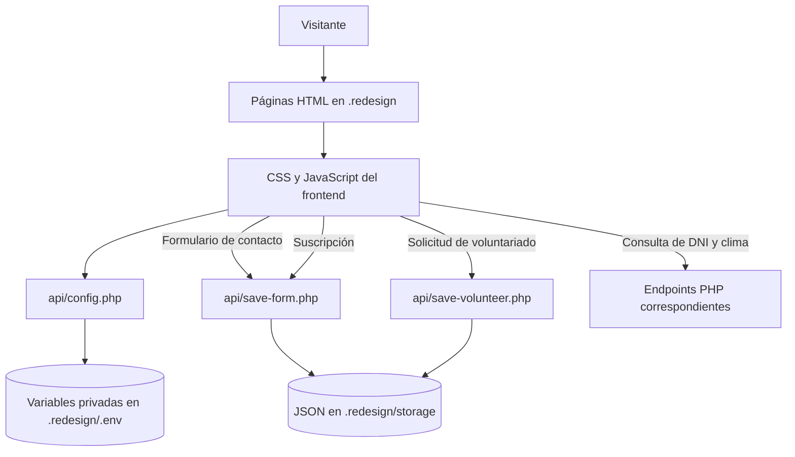

# Wiesse & Consultores ⚖️

[](https://www.linkedin.com/in/drphp/)
[](https://www.linkedin.com/in/drphp/)

<a href="https://www.instagram.com/amvsoft.tech/">
  
</a>

## Resumen ejecutivo

Wiesse & Consultores es el sitio institucional de una firma legal. La versión activa del sitio y el foco del desarrollo actual están en **[`.redesign/`](.redesign/)**: una renovación completa de la experiencia web, con páginas, componentes, estilos, scripts, recursos y endpoints propios.

Los archivos de la raíz corresponden a una versión anterior. Para ejecutar, mantener o ampliar el rediseño, trabaja dentro de `.redesign/` y conserva allí sus rutas relativas.

## Rediseño web

El rediseño incluye:

- Página principal con secciones de estudio, servicios, equipo, actualidad y contacto.
- Página de contacto con mapa y formulario de consultas.
- Tarjetas y modales de servicios con contenido e imágenes específicos.
- Formularios de contacto, suscripción al boletín y voluntariado, con validación y notificaciones Alertify.
- Búsqueda local en el contenido de Inicio y Contacto.
- Enlaces de teléfono, WhatsApp y Calendify configurados desde variables de entorno.
- Video servido desde un recurso local, con enlace a la publicación original de TikTok.
- Endpoints PHP para formularios, configuración, clima y validación de documentos.

## Requisitos

- PHP 8.1 o posterior, con extensiones `mbstring` y `curl` habilitadas.
- Permisos de escritura para que PHP cree y actualice `.redesign/storage/`.
- Navegador moderno con soporte para `fetch`, `FormData` y `URL`.

El proyecto no depende de un servidor web ni de un framework en particular. Puede publicarse con el servidor que el equipo ya utilice —incluido un entorno Laravel si se configura para servir esta carpeta y ejecutar sus endpoints PHP—. La aplicación no usa Laravel internamente. No abras el sitio con `file://`: los formularios, la configuración y otros componentes requieren ejecución de PHP y peticiones HTTP.

## Puesta en marcha local

1. Clona el repositorio y decide qué servidor o entorno local utilizar para servir `.redesign/` y ejecutar PHP.
2. Configura las variables de `.redesign/.env` tomando como referencia `.redesign/.env.example`. No subas credenciales ni secretos al repositorio.
3. Confirma que el proceso PHP puede leer el archivo de entorno y escribir en `.redesign/storage/`, y que el servidor no publique directamente esos archivos.
4. Como opción sencilla, desde la raíz del repositorio puedes iniciar el servidor integrado de PHP:

   ```bash
   php -S 127.0.0.1:8000 -t .redesign
   ```

   Abre `http://127.0.0.1:8000/`; la página de contacto está en `http://127.0.0.1:8000/contacto.html`.

Las rutas del frontend son relativas a `.redesign/`. Al usar otro servidor, configura su document root o su publicación para conservar esas rutas y permitir la ejecución de `api/*.php`.

## Configuración de entorno

El archivo activo es **`.redesign/.env`**. El endpoint `.redesign/api/config.php` publica únicamente los valores de configuración que necesita el navegador; el archivo `.env` debe permanecer bloqueado al acceso HTTP.

Variables principales:

| Variable | Uso |
| --- | --- |
| `CALENDIFY_URL` | Destino de los botones de reserva y agendamiento. |
| `PHONE` | Teléfono visible en cabecera, contacto y secciones informativas. |
| `WHATSAPP` | Destino de los enlaces de WhatsApp. |
| `WEATHER_API` | Endpoint meteorológico consumido por `api/weather.php`. |
| `API_DNI_URL`, `API_DNI_URL_2` | Servicios para consultar y validar DNI. |
| `API_RUC_URL`, `API_RUC_URL_2` | Servicios para consultar y validar RUC. |
| `VOLUNTEERS_API_KEY` | Clave usada por la integración de voluntariado, cuando aplica. |
| `RECAPTCHA_SITE_KEY`, `RECAPTCHA_SECRET_KEY` | Configuración de reCAPTCHA si se activa en los formularios. |

Usa valores vacíos solo para integraciones opcionales no utilizadas en el entorno. Los endpoints que requieren una variable validan su configuración y responden con un error si falta o no tiene el formato esperado.

## Estructura del rediseño

```text
.redesign/
├── index.html              # Inicio y secciones principales
├── contacto.html           # Página de contacto
├── head.html                # Cabecera y navegación compartidas
├── footer.html              # Pie compartido
├── modal_form.html          # Formulario modal de voluntariado
├── css/                     # Estilos del rediseño y dependencias
├── js/                      # Componentes y lógica del frontend
├── images/                  # Imágenes, iconos y recursos gráficos
├── resources/               # Recursos locales, incluido el video
├── api/                     # Endpoints PHP
│   ├── config.php           # Configuración pública controlada
│   ├── save-form.php        # Consultas de contacto y suscripciones
│   ├── save-volunteer.php   # Solicitudes de voluntariado
│   ├── dni.php              # Validación de DNI
│   └── weather.php          # Datos meteorológicos
└── storage/                 # Datos JSON persistidos; acceso HTTP bloqueado
```

Los fragmentos compartidos `head.html`, `footer.html` y `modal_form.html` se insertan mediante `js/includes.js`. Al cambiar markup compartido, verifica ambas páginas (`index.html` y `contacto.html`).

## Formularios y persistencia

- Contacto: `api/save-form.php` valida los campos y guarda registros en `storage/contact-inquiries.json`.
- Suscripción: el mismo endpoint guarda suscriptores en `storage/newsletter-subscribers.json` y evita duplicados por correo.
- Voluntariado: `api/save-volunteer.php` valida los datos y escribe en `storage/volunteers.json`.
- Los endpoints crean el directorio de almacenamiento cuando hace falta y usan bloqueo de archivo durante la escritura.
- Protege `.redesign/.env` y `.redesign/storage/` contra solicitudes HTTP directas. La configuración del servidor elegido debe aplicar esa restricción; las reglas `.htaccess` incluidas solo tienen efecto en servidores que las soporten.

No expongas datos de formularios en páginas públicas ni registres credenciales en el control de versiones. Conserva copias de seguridad de los JSON de producción según la política de operación del sitio.

## Flujo de la aplicación



## Convenciones de desarrollo

- Mantén la separación de responsabilidades: estructura en HTML, presentación en `css/` y comportamiento en `js/`; evita estilos y scripts inline.
- Reutiliza componentes, clases y patrones que ya existan dentro de `.redesign/`.
- Mantén las etiquetas, mensajes, atributos accesibles y textos de interfaz en español.
- Valida la información tanto en el navegador como en el endpoint PHP; la validación del cliente no sustituye a la del servidor.
- Construye contenido dinámico con APIs DOM y `textContent`, evitando insertar datos de usuario como HTML.
- No guardes secretos en JavaScript, HTML ni respuestas públicas del servidor.
- Verifica rutas, estados vacíos, errores y visualización responsive al editar páginas compartidas.

## Verificación antes de entregar

```bash
php -l .redesign/api/config.php
php -l .redesign/api/save-form.php
php -l .redesign/api/save-volunteer.php
node --check .redesign/js/custom.js
git diff --check
```

Prueba en el servidor elegido el envío válido e inválido de los formularios, las respuestas de los endpoints y que los archivos bajo `storage/` no sean descargables desde el navegador.

## Contexto para contribuciones

Las reglas de interfaz y las notas operativas para colaboradores y asistentes se encuentran en [.ia-context/FRONTEND_RULES.md](.ia-context/FRONTEND_RULES.md) y [.ia-context/AGENTS_ROLES.md](.ia-context/AGENTS_ROLES.md). Al realizar cambios, prioriza el rediseño ubicado en `.redesign/`.
