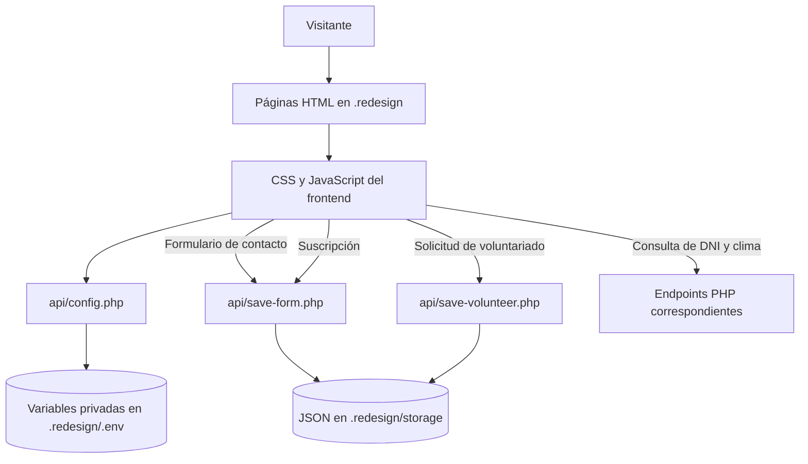

# Wiesse & Consultores ⚖️

[](https://www.linkedin.com/in/drphp/)
[](https://www.linkedin.com/in/drphp/)

<a href="https://www.instagram.com/amvsoft.tech/">
  
</a>

Wiesse & Consultores es el sitio institucional de una firma legal. La versión vigente y el foco de mantenimiento están en **[`.redesign/`](.redesign/)**, una renovación integral de la experiencia web con páginas, componentes compartidos, recursos visuales y endpoints PHP.

Los archivos web de la raíz corresponden a una versión anterior. Para ejecutar, mantener o ampliar el sitio vigente, trabaja dentro de `.redesign/`; conserva su estructura y las rutas relativas entre páginas, recursos y endpoints.

## Rediseño web

- Página principal con secciones de estudio, servicios, equipo, actualidad y contacto.
- Página de contacto con mapa y formulario de consultas.
- Tarjetas y modales de servicios con contenido e imágenes específicos.
- Formularios de contacto, suscripción al boletín y voluntariado, con validación y notificaciones Alertify.
- Búsqueda local en el contenido de Inicio y Contacto.
- Enlaces de teléfono, WhatsApp y Calendify configurados desde variables de entorno.
- Video servido desde un recurso local, con enlace a la publicación original de TikTok.
- Endpoints PHP para formularios, configuración, clima y validación de documentos.

El frontend no requiere un proceso de compilación ni gestores de paquetes. Las dependencias visuales se encuentran en `css/` y `js/`; algunos servicios externos —como mapas, clima y Alertify— requieren acceso a sus proveedores.

## Requisitos

- PHP 8.1 o posterior, con extensiones `mbstring` y `curl` habilitadas.
- Permisos de escritura para que PHP cree y actualice `.redesign/storage/`.
- Navegador moderno con soporte para `fetch`, `FormData` y `URL`.
- No se requiere Composer, Node.js ni un framework para ejecutar la web.

El proyecto no depende de un servidor web ni de un framework en particular. Puede publicarse con el servidor que el equipo ya utilice —incluido un entorno Laravel si se configura para servir esta carpeta y ejecutar sus endpoints PHP—. La aplicación no usa Laravel internamente. No abras el sitio con `file://`: los formularios, la configuración y otros componentes requieren ejecución de PHP y peticiones HTTP.

## Puesta en marcha local

1. Clona el repositorio y elige un servidor o entorno local que publique `.redesign/` y ejecute PHP. Puede ser el servidor integrado de PHP, un servidor de desarrollo de Laravel debidamente configurado u otro servidor compatible.
2. Crea `.redesign/.env` a partir de `.redesign/.env.example` y configura las variables requeridas para el entorno. No copies secretos al repositorio.
3. Verifica que PHP pueda leer `.redesign/.env`, escribir en `.redesign/storage/` y que el servidor bloquee el acceso HTTP directo a ambos.
4. Para desarrollo local sin framework, inicia el servidor integrado de PHP desde la raíz del repositorio:

   ```bash
   php -S 127.0.0.1:8000 -t .redesign
   ```

   Abre `http://127.0.0.1:8000/`; la página de contacto está en `http://127.0.0.1:8000/contacto.html`.

Las rutas del frontend son relativas a `.redesign/`. En producción, configura el document root o la publicación para conservar esas rutas, ejecutar `api/*.php` y no exponer archivos de configuración o almacenamiento. Si se integra en un entorno Laravel, hay que configurar explícitamente la ejecución de estos endpoints; el proyecto no depende de Laravel ni de sus rutas.

## Configuración de entorno

El archivo activo es **`.redesign/.env`**. `.redesign/api/config.php` lee las variables del servidor y devuelve al navegador solo los valores públicos de configuración (`CALENDIFY_URL`, `PHONE`, `WHATSAPP`). No cargues el archivo `.env` desde JavaScript ni lo sirvas como archivo estático.

Variables principales:

| Variable | Requerida | Uso |
| --- | --- | --- |
| `CALENDIFY_URL` | Sí | Destino de los botones de reserva y agendamiento. |
| `PHONE` | Sí | Teléfono visible en cabecera, contacto y secciones informativas. |
| `WHATSAPP` | Sí | URL de destino de los enlaces de WhatsApp. |
| `WEATHER_API` | Para clima | Endpoint consultado por `api/weather.php`. |
| `API_DNI_URL`, `API_DNI_URL_2` | Para DNI | Proveedores usados por `api/dni.php`. |
| `API_RUC_URL`, `API_RUC_URL_2` | Según integración | Proveedores para consultas de RUC. |
| `VOLUNTEERS_API_KEY` | Según integración | Clave usada por la API de voluntariado. |
| `RECAPTCHA_SITE_KEY`, `RECAPTCHA_SECRET_KEY` | Según integración | Claves de reCAPTCHA si se habilita esta protección. |

No uses valores vacíos para variables marcadas como requeridas. Los secretos de integraciones se mantienen en el entorno del servidor y nunca se devuelven al navegador. Configura solo las integraciones que realmente utilice cada entorno.

## Estructura del rediseño

```text
.redesign/
├── index.html              # Inicio y secciones principales
├── contacto.html           # Página de contacto
├── head.html                # Cabecera y navegación compartidas
├── footer.html              # Pie compartido
├── modal_form.html          # Formulario modal de voluntariado
├── css/                     # Estilos del rediseño y dependencias
├── js/                      # Componentes y lógica del frontend
├── images/                  # Imágenes, iconos y recursos gráficos
├── resources/               # Recursos locales, incluido el video
├── api/                     # Endpoints PHP
│   ├── config.php           # Configuración pública controlada
│   ├── save-form.php        # Consultas de contacto y suscripciones
│   ├── save-volunteer.php   # Solicitudes de voluntariado
│   ├── volunteers.php       # API de gestión de solicitudes de voluntariado
│   ├── dni.php              # Validación de DNI
│   └── weather.php          # Datos meteorológicos
└── storage/                 # Datos JSON persistidos; acceso HTTP bloqueado
```

Los fragmentos compartidos `head.html`, `footer.html` y `modal_form.html` se insertan mediante `js/includes.js`. Al cambiar markup compartido, verifica ambas páginas (`index.html` y `contacto.html`).

## Formularios y persistencia

- Contacto: `api/save-form.php` valida los campos y guarda registros en `storage/contact-inquiries.json`.
- Suscripción: el mismo endpoint guarda suscriptores en `storage/newsletter-subscribers.json` y evita duplicados por correo.
- Voluntariado: `api/save-volunteer.php` valida los datos y escribe en `storage/volunteers.json`.
- Los endpoints crean el directorio de almacenamiento cuando hace falta y usan bloqueo de archivo durante la escritura.
- Protege `.redesign/.env` y `.redesign/storage/` contra solicitudes HTTP directas. La configuración del servidor elegido debe aplicar esa restricción; las reglas `.htaccess` incluidas solo tienen efecto en servidores que las soporten.

No expongas datos de formularios en páginas públicas ni registres credenciales en el control de versiones. Conserva copias de seguridad de los JSON de producción según la política de operación del sitio. Antes de publicar, retira datos de prueba y confirma que los archivos JSON no sean descargables desde el navegador.

## Flujo de la aplicación



### Endpoints principales

| Endpoint | Responsabilidad |
| --- | --- |
| `api/config.php` | Devuelve al frontend las variables públicas de configuración. |
| `api/save-form.php` | Valida y persiste las consultas y suscripciones. |
| `api/save-volunteer.php` | Valida y persiste solicitudes de voluntariado. |
| `api/volunteers.php` | API de gestión de solicitudes; proteger y restringir según el entorno de operación. |
| `api/dni.php` | Consulta información para validar DNI. |
| `api/weather.php` | Obtiene los datos meteorológicos configurados. |

## Convenciones de desarrollo

- Mantén la separación de responsabilidades: estructura en HTML, presentación en `css/` y comportamiento en `js/`; evita estilos y scripts inline.
- Reutiliza componentes, clases y patrones que ya existan dentro de `.redesign/`.
- Mantén las etiquetas, mensajes, atributos accesibles y textos de interfaz en español.
- Valida la información tanto en el navegador como en el endpoint PHP; la validación del cliente no sustituye a la del servidor.
- Construye contenido dinámico con APIs DOM y `textContent`, evitando insertar datos de usuario como HTML.
- No guardes secretos en JavaScript, HTML ni respuestas públicas del servidor.
- Verifica rutas, estados vacíos, errores y visualización responsive al editar páginas compartidas.

## Verificación antes de entregar

```bash
php -l .redesign/api/config.php
php -l .redesign/api/save-form.php
php -l .redesign/api/save-volunteer.php
node --check .redesign/js/custom.js
git diff --check
```

Prueba en el servidor elegido el envío válido e inválido de los formularios, las respuestas de los endpoints y que los archivos bajo `storage/` no sean descargables desde el navegador.

Para una revisión previa al despliegue, confirma además que `.redesign/.env` corresponda al entorno, que `storage/` tenga permisos mínimos de escritura y que los formularios muestren correctamente sus estados de carga, éxito y error.

## Contexto para contribuciones

Las reglas de interfaz y las notas operativas para colaboradores y asistentes se encuentran en [.ia-context/FRONTEND_RULES.md](.ia-context/FRONTEND_RULES.md) y [.ia-context/AGENTS_ROLES.md](.ia-context/AGENTS_ROLES.md). Al realizar cambios, prioriza el rediseño ubicado en `.redesign/`.
